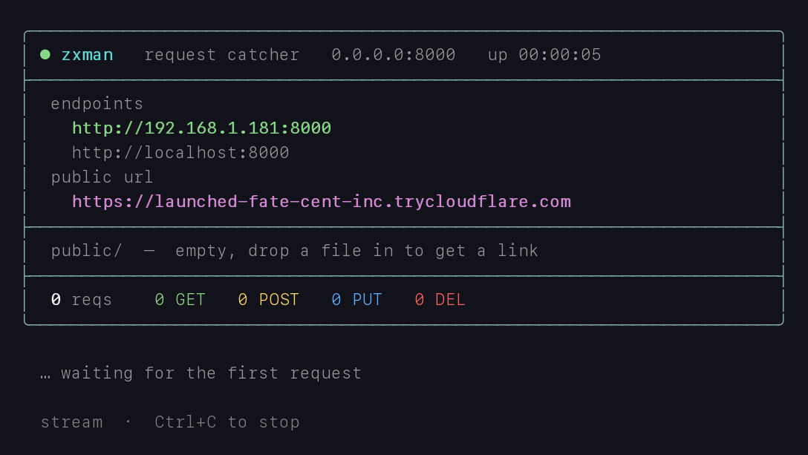
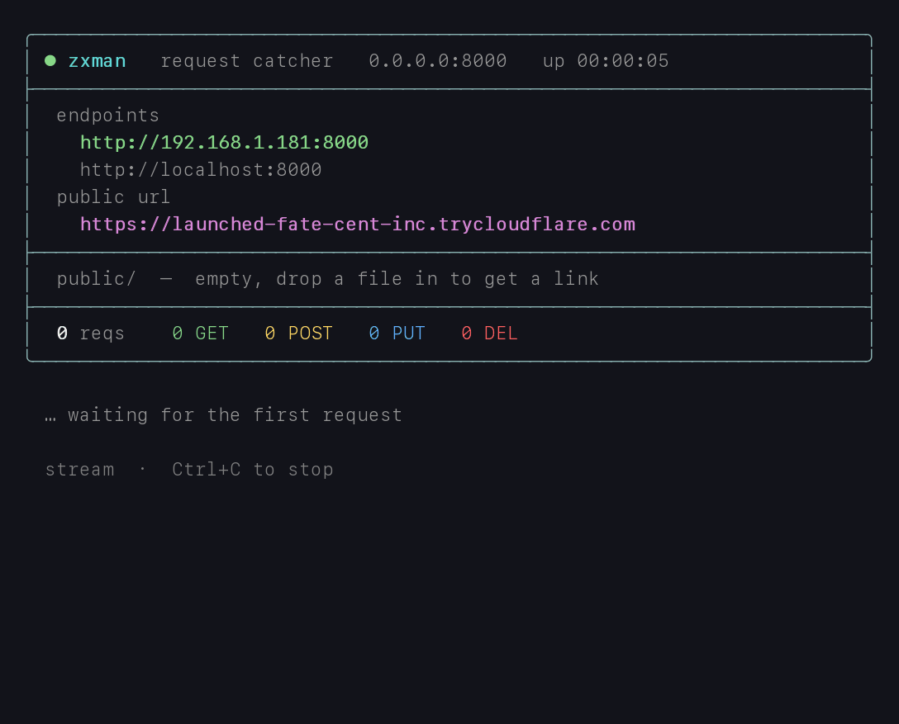
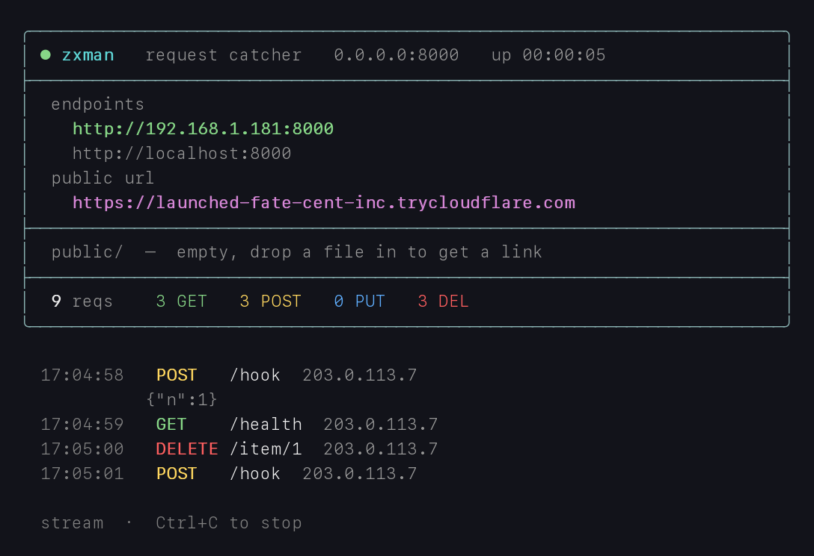
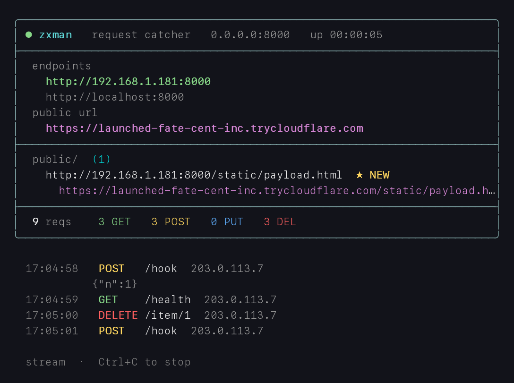
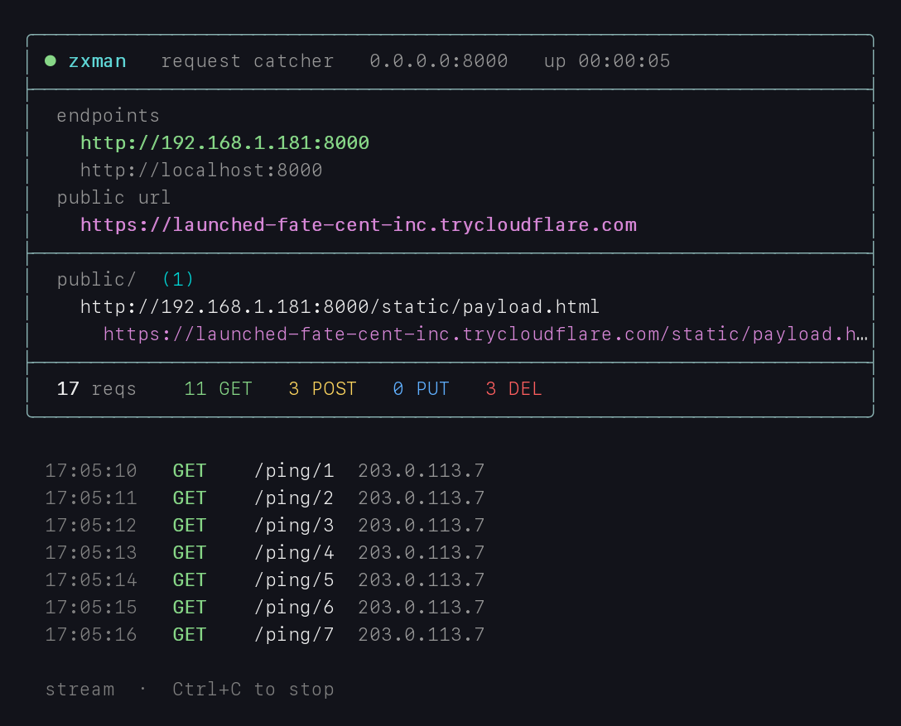

# zxman

> A tiny, dependency-light HTTP **request catcher** with a live colour terminal
> dashboard and a one-command public tunnel.


**zxman** captures every incoming HTTP request — method, path, query, headers
and body — and serves static files from `./public`. Everything shows live on a
256-colour dashboard, and an optional `cloudflared` tunnel gives you a public
URL in seconds.

Handy for inspecting webhooks, debugging clients, collecting out-of-band
callbacks, or handing someone a one-off public URL to hit.



## Contents

- [Features](#features)
- [Demo](#demo)
- [Screenshots](#screenshots)
- [Requirements](#requirements)
- [Installation](#installation)
  - [Quick start](#quick-start)
  - [Kali Linux / Debian](#kali-linux--debian)
- [Usage](#usage)
- [Configuration](#configuration)
- [Captured hit format](#captured-hit-format)
- [How it works](#how-it-works)
- [Project layout](#project-layout)
- [Security](#security)
- [License](#license)

## Features

- **Catches everything.** Any path other than `/static/*` is captured and logged
  to `requests.log` (one JSON line each) plus a pretty `hits/*.json` file.
- **Serves files.** Drop a file into `./public` and it's live at
  `/static/<file>` — never counted as a hit.
- **Live dashboard.** A 256-colour terminal UI shows your endpoints, the public
  tunnel URL, the files in `./public` (with copy-ready local **and** public
  links), running totals per method, and a rolling request stream.
- **Auto-detects new files** dropped into `./public` and flags them `★ NEW`.
- **One-command public URL** via `cloudflared` — no account or config needed.
- **Adapts to the terminal width**, so long tunnel URLs are never truncated.
- **CORS-friendly.** Sends permissive CORS headers and answers `OPTIONS`, so
  browser `fetch` callbacks work.
- **Safe output.** Control characters in request paths/bodies are escaped before
  they reach your terminal, so a remote caller can't rewrite your screen.
- **Binary-safe recording.** Non-UTF-8 bodies are preserved as base64 instead of
  being dropped.

## Demo



> The GIF above and the screenshots below are previews of the UI, committed so
> the README looks complete out of the box.

## Screenshots

| Startup | Captured traffic |
|---------|------------------|
|  |  |

| New file flagged | Request stream |
|------------------|----------------|
|  |  |

## Requirements

| Dependency    | Needed for            | Notes                                    |
|---------------|-----------------------|------------------------------------------|
| Ruby 3.0+     | everything            | see `.ruby-version`                      |
| `webrick` gem | the HTTP server       | removed from Ruby's default gems in 3.0  |
| `cloudflared` | the public tunnel     | optional; runs local-only without it     |

## Installation

### Quick start

```sh
# 1. Get the code
git clone <your-repo-url> zxman
cd zxman

# 2. Install dependencies
make install                      # or: bundle install

# 3. (Optional) install cloudflared for the public tunnel
brew install cloudflared          # macOS — see Kali section for Linux

# 4. Run it
make run                          # or, local-only: make public
```

The dashboard appears and prints your local URLs — plus a public
`https://…trycloudflare.com` URL once the tunnel is up. Send it a request from
another terminal:

```sh
curl -X POST http://localhost:8000/hook -d '{"event":"ping"}'
```

Watch it appear live on the dashboard; it's also saved to `requests.log` and
`hits/*.json`. Stop with `Ctrl+C`.

**Other ways to run:**

```sh
make public           # run without the cloudflared tunnel (TUNNEL=0)
./server.rb           # run the script directly (needs webrick)
ruby server.rb -h     # show the manual (all options and env vars)
make help             # list all make targets
```

### Kali Linux / Debian

Kali Rolling ships Ruby 3.x, so everything is available through `apt`.

**1. Ruby, build tools and WEBrick**

```sh
sudo apt update
sudo apt install -y ruby ruby-dev ruby-webrick build-essential git
ruby --version        # expect 3.0 or newer
```

> `ruby-webrick` provides the gem system-wide. If you prefer Bundler, skip it
> and run `sudo gem install bundler` instead, then use `make install`.

**2. (Optional) `cloudflared`** for the public tunnel. Pick one method and the
architecture that matches `dpkg --print-architecture` (`amd64` or `arm64`).

*Method A — official `.deb`:*

```sh
# amd64 (most installs)
wget https://github.com/cloudflare/cloudflared/releases/latest/download/cloudflared-linux-amd64.deb
sudo dpkg -i cloudflared-linux-amd64.deb

# arm64 (e.g. Kali on Raspberry Pi / Apple Silicon VM)
# wget https://github.com/cloudflare/cloudflared/releases/latest/download/cloudflared-linux-arm64.deb
# sudo dpkg -i cloudflared-linux-arm64.deb
```

*Method B — standalone binary* (no package manager; works anywhere on `PATH`):

```sh
# arm64
wget https://github.com/cloudflare/cloudflared/releases/latest/download/cloudflared-linux-arm64 -O cloudflared
chmod +x cloudflared && sudo mv cloudflared /usr/local/bin/

# amd64 — swap the filename:
# wget https://github.com/cloudflare/cloudflared/releases/latest/download/cloudflared-linux-amd64 -O cloudflared
# chmod +x cloudflared && sudo mv cloudflared /usr/local/bin/
```

Verify either way:

```sh
cloudflared --version
```

**3. Get zxman and run it**

```sh
git clone <your-repo-url> zxman
cd zxman
ruby server.rb                # tunnel on; or: TUNNEL=0 ruby server.rb
```

With `ruby-webrick` installed via `apt`, run the script directly as above. The
`make run` / `make public` targets go through Bundler — use those only if you
installed with `bundle install`.

To bind the default HTTP port so others reach it without a port number (needs
root):

```sh
sudo PORT=80 ruby server.rb
```

> On Kali the default user is often already `root`; drop `sudo` where it isn't
> needed.

## Usage

**Catch a request** — anything that isn't `/static/*` is recorded and echoed on
the dashboard:

```sh
curl -X POST http://localhost:8000/hook -d '{"event":"ping"}'
# → {"status":"ok","seq":1}
```

**Serve a file** — drop it into `./public` and open the printed link:

```sh
echo '<h1>hi</h1>' > public/index.html
curl http://localhost:8000/static/index.html
```

**Clear captured data** between runs:

```sh
make clean            # removes hits/ and requests.log
```

## Configuration

All configuration is through environment variables:

| Variable     | Default | Effect                                                         |
|--------------|---------|----------------------------------------------------------------|
| `PORT`       | `8000`  | Port to bind on `0.0.0.0`.                                      |
| `TUNNEL`     | `1`     | `0` disables the automatic `cloudflared` tunnel.               |
| `INDEX`      | `0`     | `1` lets `/static` browse the directory listing.               |
| `KILL_PORT`  | `0`     | `1` lets the server terminate whatever process holds the port. |
| `NO_COLOR`   | —       | Set (any value) to disable all colour output.                  |

```sh
PORT=9000 TUNNEL=0 ruby server.rb      # port 9000, local only, no tunnel
```

## Captured hit format

Each captured request is appended to `requests.log` and written to
`hits/<timestamp>-<rand>.json`:

```json
{
  "time": "2026-10-12T17:05:00+00:00",
  "ip": "203.0.113.7",
  "method": "POST",
  "path": "/hook",
  "query": {},
  "headers": { "content-type": "application/json", "host": "..." },
  "body": "{\"event\":\"ping\"}"
}
```

Binary bodies appear as `body_base64` instead of `body`. When behind the tunnel,
`ip` is taken from `CF-Connecting-IP` / `X-Forwarded-For`.

## How it works

A single [`WEBrick`](https://github.com/ruby/webrick) server mounts one servlet
at `/`. For each request it decides internally:

- **`/static/*`** → handed to a file handler rooted at `./public` (not logged).
- **anything else** → captured, persisted, counted, and printed to the stream.

Background threads keep the UI live without blocking requests: one runs
`cloudflared` and watches for the public URL, another polls `./public` for new
files, and all terminal drawing goes through a single mutex so output never
interleaves. It's one file — [`server.rb`](server.rb) — with no framework.

## Project layout

```
server.rb         the whole server (single file)
public/           files served under /static — drop payloads here
hits/             one JSON file per captured request   (git-ignored)
requests.log      one JSON line per captured request   (git-ignored)
Gemfile           declares the webrick dependency
Makefile          install / run / public / demo / clean targets
docs/             screenshots and the demo.gif used in this README
```

## Security

zxman is a debugging tool, not a hardened service. When you expose it:

- **The tunnel is public.** Anyone with the `https://…trycloudflare.com` URL can
  reach `/static` and send captured hits. Only run it when you mean to.
- **Captured data stays on disk.** `hits/` and `requests.log` grow with every
  request and may contain secrets from the bodies and headers you receive. They
  are git-ignored; clear them with `make clean`.
- **Directory listing is off by default** (`INDEX=0`); enable it only
  deliberately.
- **`KILL_PORT` can terminate other processes** — it's off by default and
  opt-in for good reason.

## License

No license is set yet. Add a `LICENSE` file (e.g. MIT) before sharing publicly
if you want others to reuse the code.
